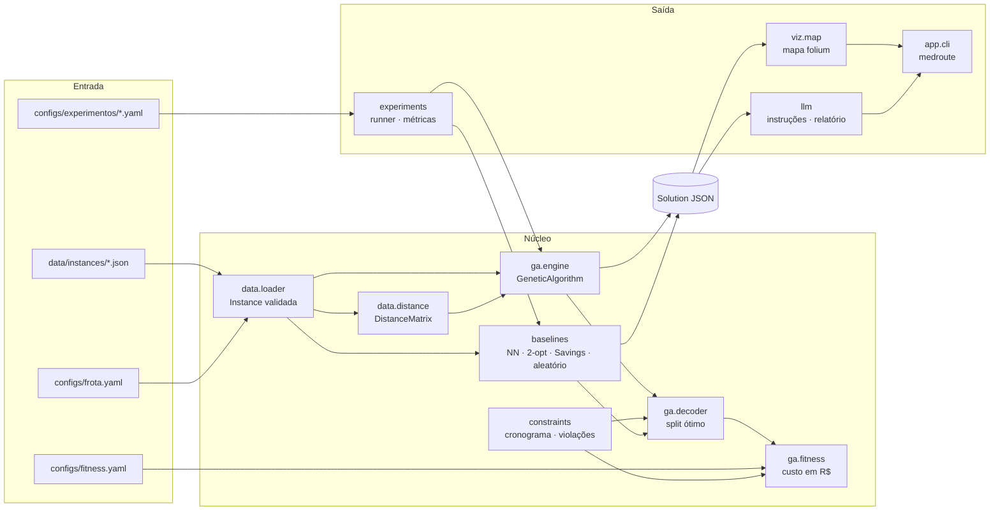
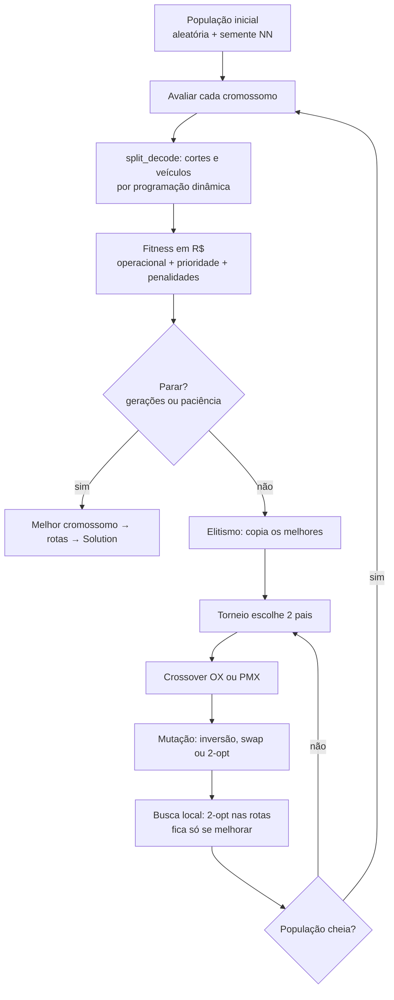
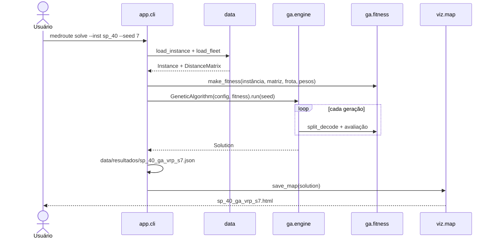
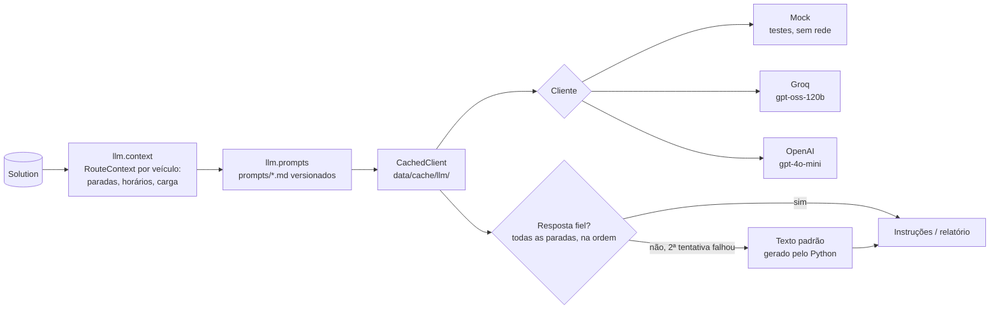

# Arquitetura do medroute

**Autor:** Conrado (Parte A) · **Requisito:** R17 (documentação com diagramas de arquitetura)
Os diagramas são Mermaid: o GitHub renderiza direto nesta página.

O `medroute` resolve um problema de roteamento de veículos com frota heterogênea (VRP) para a distribuição de
medicamentos a partir da farmácia central do HC-FMUSP. Um algoritmo genético gera as rotas; heurísticas clássicas
servem de comparação; uma LLM transforma a solução em instruções para motoristas e relatórios.

---

## 1. Visão geral

**Regra central:** a `Solution` (em `domain/models.py`, congelada na S0) é a única interface entre quem
**otimiza** (GA, baselines) e quem **consome** (mapa, LLM, experimentos, CLI). Por isso as partes D e E puderam
começar sobre uma fixture (`tests/fixtures/solution_sp15.json`) antes de o GA existir.

## 2. Módulos

| Pacote | Responsável | Spec | Papel |
|---|---|---|---|
| `domain/` | Conrado + Beatriz | 01 | Modelos Pydantic: `Delivery`, `Vehicle`, `Depot`, `Instance`, `Route`, `Solution`. |
| `data/` | Beatriz | 01 | Gerador de instâncias com seed, loader/validação, `FleetConfig`, `DistanceMatrix` (haversine × 1,30; tempo por velocidade e fator de trânsito). |
| `constraints/` | Beatriz | 03 | Funções puras: `cronograma_rota`, `duracao_rota`, `custo_prioridade`, violações de capacidade, autonomia, compatibilidade, deadline e jornada. |
| `ga/` | Conrado | 02, 03 | Encoding (*giant tour*), operadores, decoders (guloso e split ótimo), fitness em R$, motor com elitismo, paciência e modo híbrido. |
| `baselines/` | Pedro | README | Vizinho mais próximo, NN + 2-opt, Clarke-Wright Savings, aleatório. Usam o mesmo split e fitness do GA. |
| `experiments/` | Pedro | README | Runner YAML (instâncias × configurações × seeds), métricas, resumo e exportação CSV/JSON. |
| `llm/` | Rodrigo | 05 | Cliente (mock, Groq, OpenAI), prompts versionados, contexto da rota, instruções por motorista, relatório diário/semanal, cache em disco. |
| `viz/` | Alexandre | README | Mapa folium: uma cor por veículo, ícone por prioridade, popup com ordem, carga e prazo. |
| `app/` | Alexandre | README | CLI `typer`: `demo`, `gen`, `solve`, `map`, `instruct`, `compare` (runner), `report` e `ask` (LLM) e `app`; app Streamlit (`streamlit_app.py`) com o fluxo completo. |

Dependências só apontam "para dentro": `domain` não importa nada do projeto; `data` e `constraints` dependem só
de `domain`; `ga` e `baselines` dependem dos três; `llm`, `viz`, `experiments` e `app` ficam na borda.

## 3. O algoritmo genético

- O fitness de cada cromossomo é guardado em cache: elites e filhos repetidos não são decodificados de novo.
- A seed controla toda a aleatoriedade (`random.Random(seed)`): mesma seed, mesma solução.
- Detalhes e o comparativo com o código base da FIAP: [`do-tsp-ao-vrp.md`](do-tsp-ao-vrp.md).

## 4. Fluxo do `medroute solve`

## 5. Camada de LLM

- **O Python calcula, a LLM redige.** Indicadores, tabelas e padrões do relatório saem do código; a LLM escreve
  só o texto analítico. Assim os números do relatório não dependem do modelo.
- **Fidelidade verificada:** as instruções só são aceitas se citam todas as paradas na ordem da rota; com uma
  nova tentativa e, se falhar, um texto padrão. O relatório exige as três seções.
- **Cache:** a mesma entrada devolve a mesma resposta sem nova chamada, o que poupa a cota do Groq e deixa as
  execuções do relatório e do vídeo reproduzíveis.

## 6. Configuração e dados

| Arquivo | Conteúdo | Quem usa |
|---|---|---|
| `configs/frota.yaml` | Tipos e quantidades de veículo, capacidade, autonomia, velocidade, custos, tempo de serviço, jornada, faixas de trânsito | `data`, `constraints`, `ga` |
| `configs/fitness.yaml` | R$/min por prioridade e penalidades (fixo + unitário) | `ga.fitness`, split ótimo |
| `configs/experimentos/*.yaml` | Instâncias, seeds e configurações do GA de cada rodada | `experiments.runner` |
| `data/instances/*.json` | `sp_15`, `sp_40`, `sp_80`: unidades reais do HC + domicílios sintéticos (seed 42) | todos |
| `data/resultados/`, `reports/` | Soluções, métricas e evidências das rodadas | relatório |
| `.env` (fora do git) | Chaves e modelo da LLM; modelo em `.env.example` | `llm.client` |

Decisões que moldam a arquitetura estão em `docs/adr/`: sem janelas de tempo completas (0001), sem nuvem (0002),
distância haversine × fator (0003), fitness em R$ (0004), frota fixa de três tipos (0005) e specs como contratos
entre módulos (0006).

## 7. Qualidade

- **Testes:** `tests/unit/<pacote>/` para cada módulo e `tests/integration/` para os fluxos ponta a ponta em
  `sp_15` e `sp_40`. A LLM roda sempre em modo mock nos testes.
- **CI:** GitHub Actions em cada PR e push na `main` (`.github/workflows/`): instala o `requirements.lock`,
  roda `ruff check` e `pytest` em Python 3.11.
- **Reprodutibilidade:** instâncias geradas com seed, GA com seed, runner grava hashes SHA-256 das entradas e do
  código em `metadata.json`.
