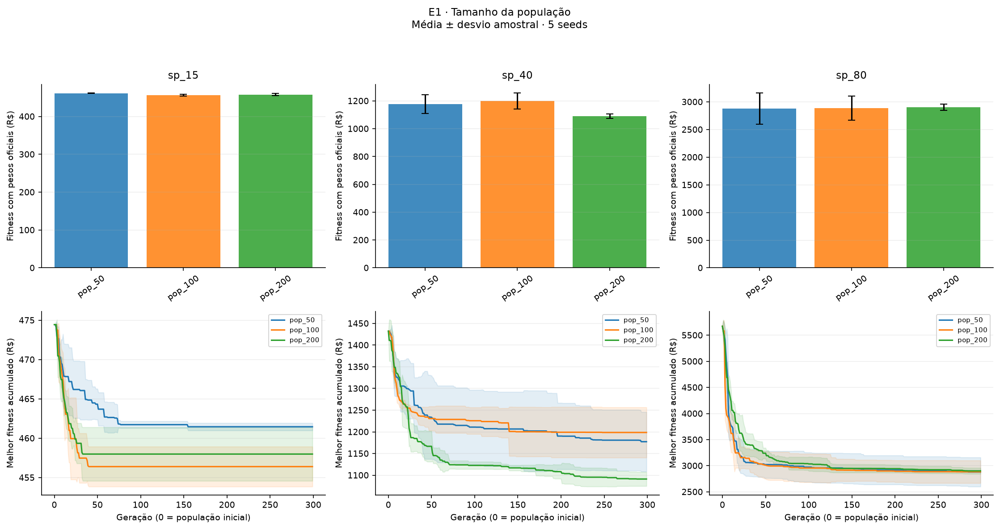
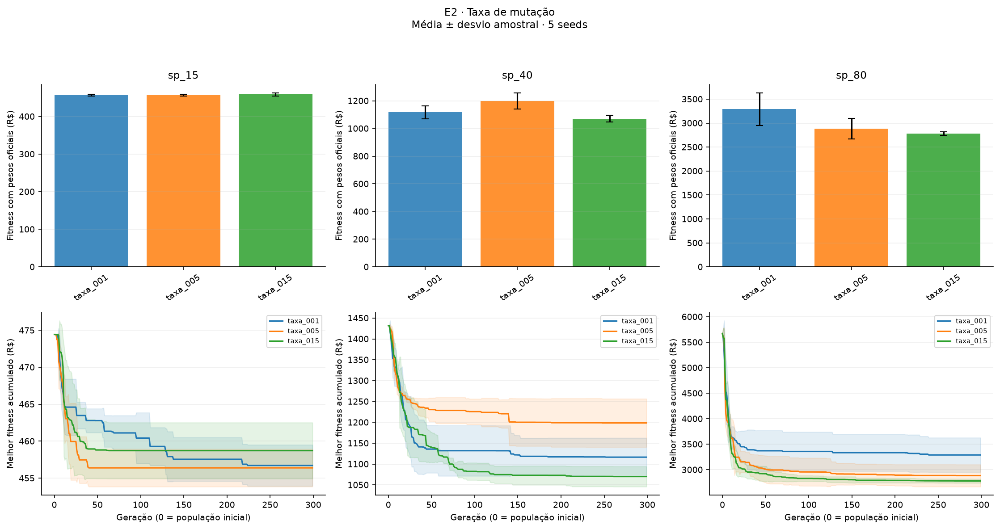
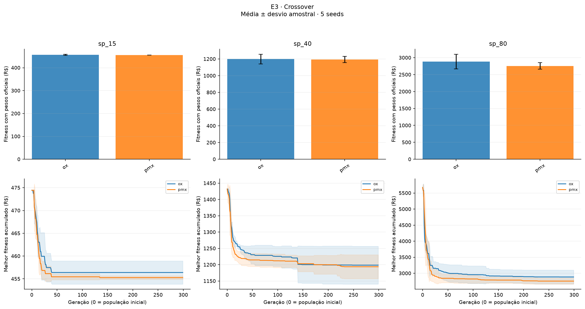
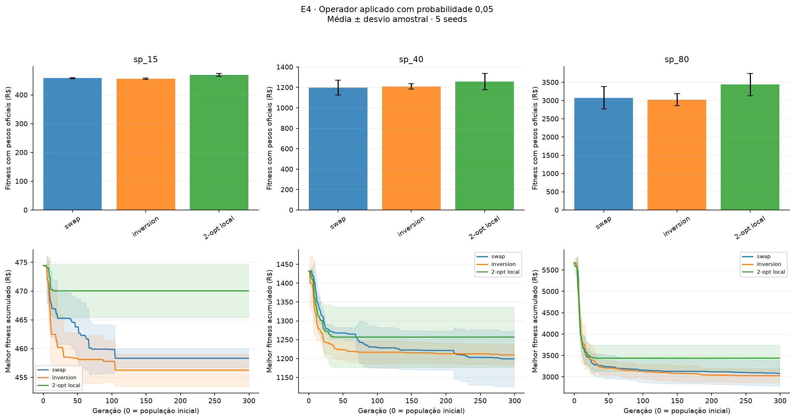
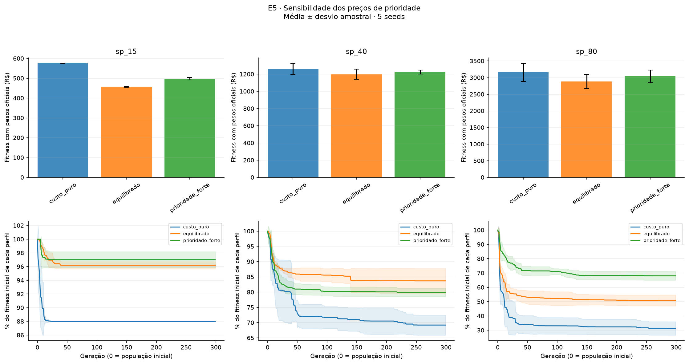
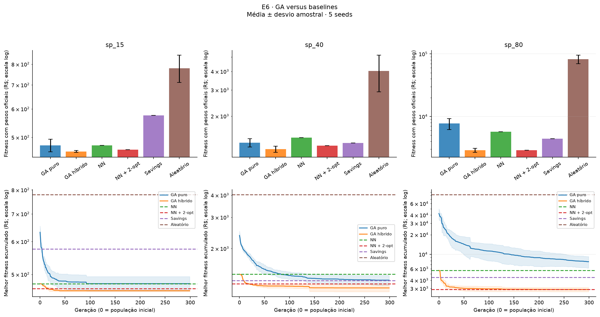

# E1–E6 — tabelas da rodada de 23/10

Cinco seeds por configuração; dp amostral. Fitness comum usa os pesos oficiais.
Em E5, fitness objetivo é específico de cada perfil e não deve ordenar os perfis.
V/E/D compara fitness comum por seed. Tempo foi medido sob concorrência.

## E1 — Tamanho da população

### sp_15

| Configuração | Fitness comum ± dp | Melhor comum | Fitness objetivo ± dp | Custo operacional ± dp | Prioridade comum ± dp | Tempo s ± dp | Violação % (hard) | V/E/D |
|---|---:|---:|---:|---:|---:|---:|---:|---:|
| pop_100 | 456.39 ± 2.54 | 454.58 | 456.39 ± 2.54 | 306.10 ± 2.93 | 150.29 ± 5.14 | 4.80 ± 0.19 | 0 (0) | 0/5/0 |
| pop_200 | 457.98 ± 3.41 | 455.41 | 457.98 ± 3.41 | 305.48 ± 3.39 | 152.51 ± 6.67 | 9.80 ± 0.17 | 0 (0) | 0/2/3 |
| pop_50 | 461.46 ± 0.48 | 460.88 | 461.46 ± 0.48 | 304.62 ± 3.05 | 156.84 ± 3.15 | 2.49 ± 0.10 | 0 (0) | 0/1/4 |

### sp_40

| Configuração | Fitness comum ± dp | Melhor comum | Fitness objetivo ± dp | Custo operacional ± dp | Prioridade comum ± dp | Tempo s ± dp | Violação % (hard) | V/E/D |
|---|---:|---:|---:|---:|---:|---:|---:|---:|
| pop_100 | 1198.57 ± 58.01 | 1115.06 | 1198.57 ± 58.01 | 770.28 ± 113.86 | 428.29 ± 66.24 | 28.79 ± 1.69 | 0 (0) | 0/5/0 |
| pop_200 | 1091.26 ± 16.31 | 1065.51 | 1091.26 ± 16.31 | 635.46 ± 16.71 | 455.80 ± 14.55 | 83.61 ± 19.54 | 0 (0) | 5/0/0 |
| pop_50 | 1177.31 ± 68.69 | 1059.51 | 1177.31 ± 68.69 | 780.46 ± 101.21 | 396.85 ± 35.83 | 16.39 ± 1.06 | 0 (0) | 3/0/2 |

### sp_80

| Configuração | Fitness comum ± dp | Melhor comum | Fitness objetivo ± dp | Custo operacional ± dp | Prioridade comum ± dp | Tempo s ± dp | Violação % (hard) | V/E/D |
|---|---:|---:|---:|---:|---:|---:|---:|---:|
| pop_100 | 2884.40 ± 216.85 | 2684.33 | 2884.40 ± 216.85 | 1149.26 ± 87.45 | 1708.01 ± 97.15 | 108.68 ± 12.12 | 40 (0) | 0/5/0 |
| pop_200 | 2901.93 ± 57.75 | 2815.94 | 2901.93 ± 57.75 | 1178.13 ± 45.00 | 1694.37 ± 62.95 | 488.57 ± 114.33 | 60 (0) | 2/0/3 |
| pop_50 | 2879.92 ± 279.83 | 2653.90 | 2879.92 ± 279.83 | 1151.69 ± 69.40 | 1694.68 ± 163.83 | 54.88 ± 4.79 | 40 (0) | 2/0/3 |

## E2 — Taxa de mutação

### sp_15

| Configuração | Fitness comum ± dp | Melhor comum | Fitness objetivo ± dp | Custo operacional ± dp | Prioridade comum ± dp | Tempo s ± dp | Violação % (hard) | V/E/D |
|---|---:|---:|---:|---:|---:|---:|---:|---:|
| taxa_001 | 456.72 ± 2.79 | 455.41 | 456.72 ± 2.79 | 306.23 ± 2.79 | 150.50 ± 5.34 | 7.12 ± 0.13 | 0 (0) | 1/2/2 |
| taxa_005 | 456.39 ± 2.54 | 454.58 | 456.39 ± 2.54 | 306.10 ± 2.93 | 150.29 ± 5.14 | 4.80 ± 0.19 | 0 (0) | 0/5/0 |
| taxa_015 | 458.72 ± 3.80 | 454.58 | 458.72 ± 3.80 | 303.94 ± 1.90 | 154.78 ± 5.28 | 7.63 ± 0.30 | 0 (0) | 1/1/3 |

### sp_40

| Configuração | Fitness comum ± dp | Melhor comum | Fitness objetivo ± dp | Custo operacional ± dp | Prioridade comum ± dp | Tempo s ± dp | Violação % (hard) | V/E/D |
|---|---:|---:|---:|---:|---:|---:|---:|---:|
| taxa_001 | 1116.56 ± 46.06 | 1070.52 | 1116.56 ± 46.06 | 652.84 ± 23.77 | 463.71 ± 38.90 | 41.02 ± 3.04 | 0 (0) | 4/0/1 |
| taxa_005 | 1198.57 ± 58.01 | 1115.06 | 1198.57 ± 58.01 | 770.28 ± 113.86 | 428.29 ± 66.24 | 28.79 ± 1.69 | 0 (0) | 0/5/0 |
| taxa_015 | 1070.07 ± 24.29 | 1043.73 | 1070.07 ± 24.29 | 621.50 ± 16.53 | 448.57 ± 20.04 | 53.64 ± 4.87 | 0 (0) | 5/0/0 |

### sp_80

| Configuração | Fitness comum ± dp | Melhor comum | Fitness objetivo ± dp | Custo operacional ± dp | Prioridade comum ± dp | Tempo s ± dp | Violação % (hard) | V/E/D |
|---|---:|---:|---:|---:|---:|---:|---:|---:|
| taxa_001 | 3289.88 ± 338.39 | 2833.56 | 3289.88 ± 338.39 | 1219.07 ± 62.05 | 1883.07 ± 204.68 | 136.59 ± 12.59 | 80 (0) | 1/0/4 |
| taxa_005 | 2884.40 ± 216.85 | 2684.33 | 2884.40 ± 216.85 | 1149.26 ± 87.45 | 1708.01 ± 97.15 | 108.68 ± 12.12 | 40 (0) | 0/5/0 |
| taxa_015 | 2779.08 ± 39.71 | 2732.15 | 2779.08 ± 39.71 | 1156.29 ± 36.89 | 1622.73 ± 26.36 | 201.24 ± 4.99 | 20 (0) | 4/0/1 |

## E3 — Crossover

### sp_15

| Configuração | Fitness comum ± dp | Melhor comum | Fitness objetivo ± dp | Custo operacional ± dp | Prioridade comum ± dp | Tempo s ± dp | Violação % (hard) | V/E/D |
|---|---:|---:|---:|---:|---:|---:|---:|---:|
| ox | 456.39 ± 2.54 | 454.58 | 456.39 ± 2.54 | 306.10 ± 2.93 | 150.29 ± 5.14 | 4.80 ± 0.19 | 0 (0) | 0/5/0 |
| pmx | 455.27 ± 0.39 | 454.58 | 455.27 ± 0.39 | 306.31 ± 1.39 | 148.97 ± 1.26 | 7.03 ± 0.38 | 0 (0) | 2/2/1 |

### sp_40

| Configuração | Fitness comum ± dp | Melhor comum | Fitness objetivo ± dp | Custo operacional ± dp | Prioridade comum ± dp | Tempo s ± dp | Violação % (hard) | V/E/D |
|---|---:|---:|---:|---:|---:|---:|---:|---:|
| ox | 1198.57 ± 58.01 | 1115.06 | 1198.57 ± 58.01 | 770.28 ± 113.86 | 428.29 ± 66.24 | 28.79 ± 1.69 | 0 (0) | 0/5/0 |
| pmx | 1193.74 ± 36.65 | 1140.39 | 1193.74 ± 36.65 | 780.94 ± 85.98 | 412.81 ± 55.09 | 35.59 ± 2.17 | 0 (0) | 2/0/3 |

### sp_80

| Configuração | Fitness comum ± dp | Melhor comum | Fitness objetivo ± dp | Custo operacional ± dp | Prioridade comum ± dp | Tempo s ± dp | Violação % (hard) | V/E/D |
|---|---:|---:|---:|---:|---:|---:|---:|---:|
| ox | 2884.40 ± 216.85 | 2684.33 | 2884.40 ± 216.85 | 1149.26 ± 87.45 | 1708.01 ± 97.15 | 108.68 ± 12.12 | 40 (0) | 0/5/0 |
| pmx | 2756.37 ± 93.46 | 2616.73 | 2756.37 ± 93.46 | 1114.63 ± 35.59 | 1635.61 ± 58.34 | 143.86 ± 5.43 | 40 (0) | 4/0/1 |

## E4 — Operador aplicado com probabilidade 0,05

### sp_15

| Configuração | Fitness comum ± dp | Melhor comum | Fitness objetivo ± dp | Custo operacional ± dp | Prioridade comum ± dp | Tempo s ± dp | Violação % (hard) | V/E/D |
|---|---:|---:|---:|---:|---:|---:|---:|---:|
| inversion | 456.26 ± 2.80 | 454.58 | 456.26 ± 2.80 | 306.80 ± 1.72 | 149.46 ± 2.11 | 0.87 ± 0.14 | 0 (0) | 0/5/0 |
| swap | 458.32 ± 1.63 | 455.41 | 458.32 ± 1.63 | 305.99 ± 0.15 | 152.33 ± 1.50 | 0.86 ± 0.13 | 0 (0) | 1/0/4 |
| two_opt_local | 470.04 ± 4.62 | 465.04 | 470.04 ± 4.62 | 309.88 ± 3.79 | 160.16 ± 5.02 | 1.72 ± 0.13 | 0 (0) | 0/0/5 |

### sp_40

| Configuração | Fitness comum ± dp | Melhor comum | Fitness objetivo ± dp | Custo operacional ± dp | Prioridade comum ± dp | Tempo s ± dp | Violação % (hard) | V/E/D |
|---|---:|---:|---:|---:|---:|---:|---:|---:|
| inversion | 1209.83 ± 26.97 | 1170.05 | 1209.83 ± 26.97 | 800.04 ± 95.38 | 409.02 ± 71.40 | 10.53 ± 1.46 | 20 (0) | 0/5/0 |
| swap | 1199.21 ± 73.19 | 1069.25 | 1199.21 ± 73.19 | 819.18 ± 101.44 | 380.03 ± 29.75 | 9.63 ± 1.11 | 0 (0) | 2/0/3 |
| two_opt_local | 1256.95 ± 80.06 | 1157.90 | 1256.95 ± 80.06 | 816.25 ± 104.29 | 440.70 ± 58.43 | 12.01 ± 3.07 | 0 (0) | 1/0/4 |

### sp_80

| Configuração | Fitness comum ± dp | Melhor comum | Fitness objetivo ± dp | Custo operacional ± dp | Prioridade comum ± dp | Tempo s ± dp | Violação % (hard) | V/E/D |
|---|---:|---:|---:|---:|---:|---:|---:|---:|
| inversion | 3027.83 ± 164.53 | 2847.96 | 3027.83 ± 164.53 | 1192.69 ± 34.23 | 1789.01 ± 138.32 | 43.37 ± 7.24 | 80 (0) | 0/5/0 |
| swap | 3077.42 ± 302.20 | 2783.88 | 3077.42 ± 302.20 | 1183.88 ± 20.29 | 1817.26 ± 234.86 | 42.51 ± 3.37 | 60 (0) | 2/0/3 |
| two_opt_local | 3438.46 ± 305.11 | 3187.56 | 3438.46 ± 305.11 | 1181.56 ± 83.27 | 1917.84 ± 105.98 | 44.25 ± 10.89 | 100 (0) | 1/0/4 |

## E5 — Sensibilidade dos preços de prioridade

### sp_15

| Configuração | Fitness comum ± dp | Melhor comum | Fitness objetivo ± dp | Custo operacional ± dp | Prioridade comum ± dp | Tempo s ± dp | Violação % (hard) | V/E/D |
|---|---:|---:|---:|---:|---:|---:|---:|---:|
| custo_puro | 574.90 ± 0.00 | 574.90 | 273.82 ± 0.00 | 273.82 ± 0.00 | 301.08 ± 0.00 | 6.51 ± 0.25 | 0 (0) | 0/0/5 |
| equilibrado | 456.39 ± 2.54 | 454.58 | 456.39 ± 2.54 | 306.10 ± 2.93 | 150.29 ± 5.14 | 4.80 ± 0.19 | 0 (0) | 0/5/0 |
| prioridade_forte | 497.54 ± 5.79 | 492.76 | 714.49 ± 8.66 | 389.07 ± 4.43 | 108.47 ± 1.50 | 7.11 ± 0.07 | 0 (0) | 0/0/5 |

### sp_40

| Configuração | Fitness comum ± dp | Melhor comum | Fitness objetivo ± dp | Custo operacional ± dp | Prioridade comum ± dp | Tempo s ± dp | Violação % (hard) | V/E/D |
|---|---:|---:|---:|---:|---:|---:|---:|---:|
| custo_puro | 1261.41 ± 63.28 | 1177.93 | 594.14 ± 28.41 | 594.14 ± 28.41 | 667.26 ± 73.42 | 43.65 ± 5.18 | 0 (0) | 2/0/3 |
| equilibrado | 1198.57 ± 58.01 | 1115.06 | 1198.57 ± 58.01 | 770.28 ± 113.86 | 428.29 ± 66.24 | 28.79 ± 1.69 | 0 (0) | 0/5/0 |
| prioridade_forte | 1224.79 ± 23.98 | 1195.70 | 1956.72 ± 34.43 | 858.83 ± 25.04 | 365.97 ± 10.90 | 41.10 ± 4.05 | 0 (0) | 2/0/3 |

### sp_80

| Configuração | Fitness comum ± dp | Melhor comum | Fitness objetivo ± dp | Custo operacional ± dp | Prioridade comum ± dp | Tempo s ± dp | Violação % (hard) | V/E/D |
|---|---:|---:|---:|---:|---:|---:|---:|---:|
| custo_puro | 3157.61 ± 269.78 | 2872.60 | 1236.01 ± 185.77 | 1173.61 ± 71.30 | 1921.59 ± 102.33 | 159.94 ± 27.47 | 40 (0) | 1/0/4 |
| equilibrado | 2884.40 ± 216.85 | 2684.33 | 2884.40 ± 216.85 | 1149.26 ± 87.45 | 1708.01 ± 97.15 | 108.68 ± 12.12 | 40 (0) | 0/5/0 |
| prioridade_forte | 3037.37 ± 193.97 | 2799.59 | 6205.56 ± 280.58 | 1224.27 ± 64.33 | 1584.09 ± 71.65 | 158.49 ± 18.82 | 100 (0) | 2/0/3 |

## E6 — GA versus baselines

### sp_15

| Configuração | Fitness comum ± dp | Melhor comum | Fitness objetivo ± dp | Custo operacional ± dp | Prioridade comum ± dp | Tempo s ± dp | Violação % (hard) | V/E/D |
|---|---:|---:|---:|---:|---:|---:|---:|---:|
| hibrido | 456.39 ± 2.54 | 454.58 | 456.39 ± 2.54 | 306.10 ± 2.93 | 150.29 ± 5.14 | 4.80 ± 0.19 | 0 (0) | 5/0/0 |
| nearest_neighbor | 474.44 ± 0.00 | 474.44 | 474.44 ± 0.00 | 311.16 ± 0.00 | 163.28 ± 0.00 | 0.00 ± 0.00 | 0 (0) | 0/0/5 |
| nearest_neighbor_two_opt | 461.72 ± 0.00 | 461.72 | 461.72 ± 0.00 | 302.02 ± 0.00 | 159.69 ± 0.00 | 0.21 ± 0.03 | 0 (0) | 0/5/0 |
| puro | 474.74 ± 19.13 | 455.54 | 474.74 ± 19.13 | 330.96 ± 31.91 | 143.78 ± 20.10 | 1.40 ± 0.24 | 0 (0) | 2/0/3 |
| random | 779.59 ± 68.36 | 713.25 | 779.59 ± 68.36 | 587.90 ± 68.29 | 191.69 ± 39.80 | 0.00 ± 0.00 | 0 (0) | 0/0/5 |
| savings | 575.96 ± 0.00 | 575.96 | 575.96 ± 0.00 | 421.90 ± 0.00 | 154.06 ± 0.00 | 0.00 ± 0.00 | 0 (0) | 0/0/5 |

### sp_40

| Configuração | Fitness comum ± dp | Melhor comum | Fitness objetivo ± dp | Custo operacional ± dp | Prioridade comum ± dp | Tempo s ± dp | Violação % (hard) | V/E/D |
|---|---:|---:|---:|---:|---:|---:|---:|---:|
| hibrido | 1198.57 ± 58.01 | 1115.06 | 1198.57 ± 58.01 | 770.28 ± 113.86 | 428.29 ± 66.24 | 28.79 ± 1.69 | 0 (0) | 5/0/0 |
| nearest_neighbor | 1432.09 ± 0.00 | 1432.09 | 1432.09 ± 0.00 | 921.43 ± 0.00 | 510.66 ± 0.00 | 0.00 ± 0.00 | 0 (0) | 0/0/5 |
| nearest_neighbor_two_opt | 1263.23 ± 0.00 | 1263.23 | 1263.23 ± 0.00 | 855.91 ± 0.00 | 407.31 ± 0.00 | 8.62 ± 0.11 | 0 (0) | 0/5/0 |
| puro | 1325.65 ± 85.45 | 1223.34 | 1325.65 ± 85.45 | 851.09 ± 123.24 | 474.56 ± 66.03 | 16.98 ± 2.29 | 0 (0) | 2/0/3 |
| random | 4030.68 ± 1115.81 | 2816.79 | 4030.68 ± 1115.81 | 1532.69 ± 61.69 | 1065.63 ± 125.46 | 0.00 ± 0.00 | 100 (0) | 0/0/5 |
| savings | 1318.14 ± 0.00 | 1318.14 | 1318.14 ± 0.00 | 815.10 ± 0.00 | 503.04 ± 0.00 | 0.01 ± 0.00 | 0 (0) | 0/0/5 |

### sp_80

| Configuração | Fitness comum ± dp | Melhor comum | Fitness objetivo ± dp | Custo operacional ± dp | Prioridade comum ± dp | Tempo s ± dp | Violação % (hard) | V/E/D |
|---|---:|---:|---:|---:|---:|---:|---:|---:|
| hibrido | 2884.40 ± 216.85 | 2684.33 | 2884.40 ± 216.85 | 1149.26 ± 87.45 | 1708.01 ± 97.15 | 108.68 ± 12.12 | 40 (0) | 4/0/1 |
| nearest_neighbor | 5672.33 ± 0.00 | 5672.33 | 5672.33 ± 0.00 | 1079.13 ± 0.00 | 1722.48 ± 0.00 | 0.02 ± 0.00 | 100 (0) | 0/0/5 |
| nearest_neighbor_two_opt | 2884.01 ± 0.00 | 2884.01 | 2884.01 ± 0.00 | 1215.79 ± 0.00 | 1656.88 ± 0.00 | 88.08 ± 0.30 | 100 (0) | 0/5/0 |
| puro | 7709.24 ± 1551.27 | 5976.80 | 7709.24 ± 1551.27 | 1760.84 ± 138.55 | 2481.26 ± 290.98 | 47.15 ± 16.31 | 100 (0) | 0/0/5 |
| random | 82585.37 ± 13157.13 | 69284.40 | 82585.37 ± 13157.13 | 2732.53 ± 77.83 | 5483.98 ± 249.01 | 0.01 ± 0.00 | 100 (100) | 0/0/5 |
| savings | 4413.51 ± 0.00 | 4413.51 | 4413.51 ± 0.00 | 1125.94 ± 0.00 | 2066.17 ± 0.00 | 0.02 ± 0.00 | 100 (0) | 0/0/5 |

