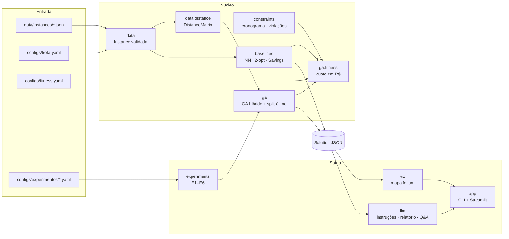

# Introdução e arquitetura

## 1. O problema

O hospital universitário distribui medicamentos e insumos a partir da Farmácia Central, no complexo do
HC-FMUSP, para as próprias unidades e para pacientes em atendimento domiciliar. Parte das entregas é crítica e
tem prazo; outra parte exige refrigeração ou não cabe numa moto. A frota é pequena e heterogênea: duas motos,
dois carros e uma van.

O enunciado pede um "caixeiro viajante médico": partir do código base de TSP da FIAP, resolvê-lo com algoritmo
genético e ampliá-lo para restrições realistas (prioridade, capacidade, autonomia e vários veículos). Também pede
uma LLM que transforme as rotas em instruções, relatórios e respostas para as equipes.

## 2. O que construímos

O `medroute` é um pacote Python com CLI e app Streamlit que faz o caminho completo:

1. **Dados:** três instâncias de São Paulo (`sp_15`, `sp_40`, `sp_80`) com 10 unidades reais do HC e domicílios
   sintéticos gerados com seed fixa, e uma frota com números conferidos em fontes públicas.
2. **Otimização:** um algoritmo genético híbrido que resolve o problema de roteamento com frota heterogênea (VRP),
   com capacidade, autonomia, prioridade, prazo das críticas, jornada de 8 h e trânsito por faixa de horário.
3. **Comparação:** quatro heurísticas de referência (aleatório, vizinho mais próximo, NN + 2-opt e Clarke-Wright
   Savings) avaliadas com a mesma função de custo, e seis experimentos (E1–E6) com 240 execuções.
4. **LLM:** instruções por motorista com horário de chegada, relatórios diário e semanal com recomendações e
   perguntas em linguagem natural sobre o plano, com avaliação automática da qualidade.
5. **Visualização:** mapa interativo das rotas, app Streamlit com o fluxo inteiro, demo ponta a ponta e notebooks.

Dois princípios atravessam o projeto:

- **Uma moeda só.** Distância, atraso, prioridade e violações viram custo em reais. Assim o GA, as heurísticas e
  os relatórios comparam soluções pelo mesmo número.
- **O Python calcula, a LLM redige.** Todo fato (ordem, horário, carga, custo, comparação) é calculado no código e
  enviado pronto; a LLM só escreve o texto, e o código confere se ela foi fiel.

## 3. Arquitetura

A `Solution` (definida em `domain/models.py` e congelada na primeira semana) é o único contrato entre quem
otimiza (GA e heurísticas) e quem consome (mapa, LLM, experimentos e app). Por isso as cinco partes do trabalho
puderam avançar em paralelo desde o início, sobre uma solução de exemplo.

| Pacote | Papel |
|---|---|
| `domain/` | modelos Pydantic: entrega, veículo, depósito, instância, rota e solução |
| `data/` | gerador de instâncias com seed, validação, frota e matriz de distâncias e tempos |
| `constraints/` | funções puras de cronograma, custo de prioridade e violações |
| `ga/` | representação, operadores, decoder (split ótimo), fitness em R$ e motor do GA |
| `baselines/` | vizinho mais próximo, NN + 2-opt, Savings e aleatório, com o mesmo split e fitness |
| `experiments/` | execução reprodutível de E1–E6, estatísticas, figuras e proveniência |
| `llm/` | cliente (mock, Groq, OpenAI), prompts versionados, instruções, relatórios, Q&A e avaliação |
| `viz/` · `app/` | mapa folium, CLI `medroute` e app Streamlit |

As dependências apontam só para dentro: `domain` não importa nada do projeto, e `llm`, `viz`, `experiments` e
`app` ficam na borda. A arquitetura completa, com o fluxo do GA, a sequência do `medroute solve` e a camada de
LLM, está em `docs/arquitetura.md`.

## 4. Como trabalhamos

- **Specs antes do código.** Cada módulo começou por uma especificação com interfaces e critérios de aceite
  (`specs/01`, `02`, `03` e `05`), revisada e aprovada por outro integrante.
- **Decisões registradas.** Sete ADRs em `docs/adr/`: sem janelas de tempo completas, sem nuvem, distância
  haversine × fator, fitness em R$, frota fixa, specs como contratos.
- **Integração contínua.** Todo PR roda `ruff` e `pytest` no GitHub Actions; a `main` termina com 418 testes.
- **Reprodutibilidade.** Instâncias, GA e experimentos usam seed; cada rodada grava hashes das entradas e do
  código.

## 5. Fonte dos números

Os resultados de otimização deste relatório vêm da **rodada S3 de 23/10** (`reports/experimentos-s3/`):
população 100, 300 gerações, mutação 0,05, cinco seeds (7, 17, 42, 73, 101), frota definitiva e trânsito. A
avaliação da LLM usa as soluções da rodada de 19/10 (`reports/comparativo-s2/`), que foi a base da rubrica; as
duas rodadas usam os mesmos dados e a mesma função de custo. A demo (`medroute solve`, `medroute demo` e o app)
usa mutação 0,2 por padrão, então os números dela não se comparam diretamente com os da S3.
