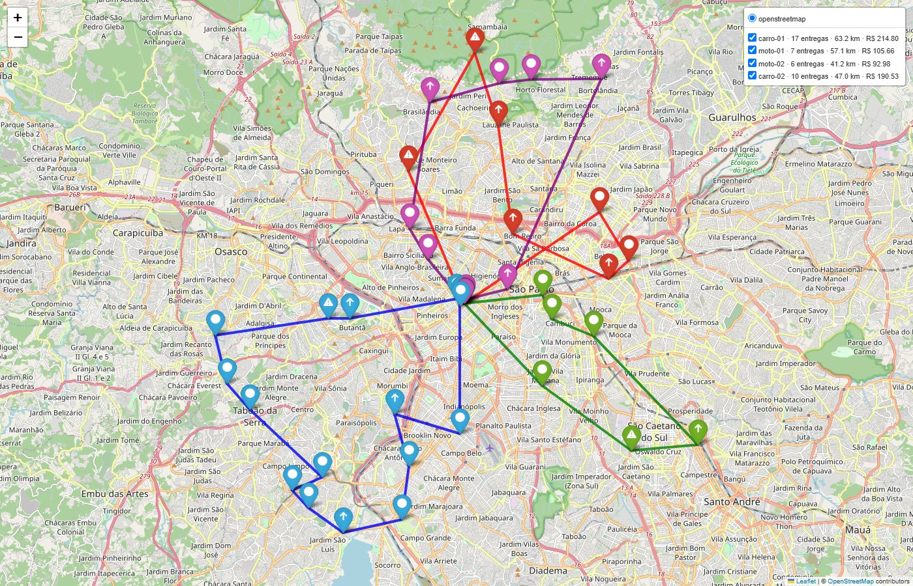

# Visualização das rotas e aplicação

Este capítulo mostra como as rotas otimizadas chegam a quem vai usá-las: no mapa, no app e na demo. As análises
gráficas dos experimentos (curvas de convergência, sensibilidade e rotas esquemáticas das melhores soluções)
estão no capítulo anterior.

## 1. Mapa interativo

`medroute map <solução>` (e a aba **Mapa** do app) gera um mapa folium sobre o OpenStreetMap
(`viz/map.py`):

- **uma cor e uma camada por veículo**, com veículo, nº de entregas, km e custo da rota na legenda; cada camada
  pode ser ligada ou desligada para olhar uma rota de cada vez;
- **ícone por prioridade:** triângulo de alerta para crítica, seta para alta, círculo para normal;
- **popup em cada parada** com a ordem na rota, o veículo, a prioridade, o prazo (críticas), a carga e se é
  refrigerada;
- o depósito em preto e o enquadramento automático em todos os pontos.

Leitura do mapa acima:

- **Setorização sem regra explícita.** Cada veículo atende uma região (norte, sul, sudoeste, leste). Ninguém
  programou isso: é o efeito do custo por km somado ao custo por minuto até a chegada.
- **A van fica parada.** Mesmo com capacidade para tudo, ela não aparece no plano: é o veículo mais caro por km e
  por dia, e quatro veículos menores atendem antes as críticas.
- **Críticas no início das rotas.** Os triângulos aparecem cedo na sequência de cada veículo, porque a crítica
  custa 10 vezes mais por minuto de espera que a normal.
- **Motos com carga leve e sem refrigerados.** As rotas das motos levam só domicílios pequenos; refrigerados e
  volumosos vão nos carros.

Os trechos são linhas retas entre as paradas. A distância usada no cálculo é haversine × 1,30 (ADR 0003), não o
traçado das ruas.

## 2. App Streamlit

`medroute app` abre o fluxo completo numa tela só (`app/streamlit_app.py`):

1. **Barra lateral:** escolha da instância, da origem (otimizar agora ou carregar uma solução salva), dos
   parâmetros do GA (seed, população, gerações, crossover e GA híbrido ou puro) e do provedor da LLM.
2. **Indicadores:** fitness, custo operacional, custo de prioridade, distância e veículos usados, com algoritmo,
   seed, gerações e tempo de execução na legenda.
3. **Abas:**
   - **Mapa:** o mesmo mapa interativo;
   - **Rotas:** tabela por veículo (entregas, críticas, km, duração, carga, custo e violações) e curva de convergência do GA;
   - **Instruções**, **Relatório** (diário ou semanal) e **Perguntas**, com exemplos prontos: os três usos da
     LLM sobre a solução exibida.

O app chama exatamente as mesmas funções da CLI, e a LLM usa o cache em disco: uma resposta já gerada aparece na
hora e não é cobrada de novo. Seis testes de integração (`tests/integration/test_streamlit_app.py`) exercitam o app
com o provedor `mock`.

## 3. Demo ponta a ponta e notebooks

- **`medroute demo`** roda o fluxo inteiro em `sp_40` com um comando: GA híbrido, mapa, instruções por motorista,
  relatório semanal e uma pergunta, salvando tudo em `data/resultados/demo/`. `--provedor openai` usa as respostas
  reais da LLM; `--rapido` reduz o GA para rodar em segundos.
- **`notebooks/01_demo_completa.ipynb`**, com as saídas salvas: dados, GA × heurísticas, rotas, convergência,
  mapa e LLM.
- **`notebooks/02_experimentos.ipynb`**, com as saídas salvas: tabelas e figuras de E1–E6, conferindo os hashes
  dos artefatos.

## 4. CLI

| Comando | O que faz |
|---|---|
| `medroute gen` | gera `sp_15`, `sp_40` e `sp_80` (seed 42) |
| `medroute solve --inst sp_40 --seed 7` | GA híbrido → `Solution` JSON + mapa HTML |
| `medroute map <solução>` | mapa de uma solução salva |
| `medroute compare --config <yaml>` | GA × heurísticas em várias seeds, com tabela-resumo |
| `medroute instruct <solução>` | instruções por motorista |
| `medroute report <soluções> --periodo diario\|semanal` | relatório com recomendações |
| `medroute ask <solução> "pergunta"` | perguntas em linguagem natural |
| `medroute demo` · `medroute app` | demo ponta a ponta · app Streamlit |
