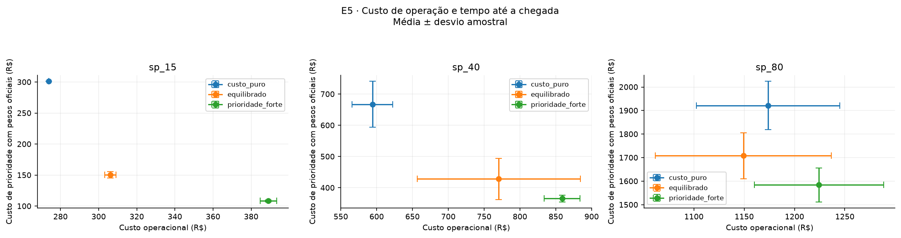
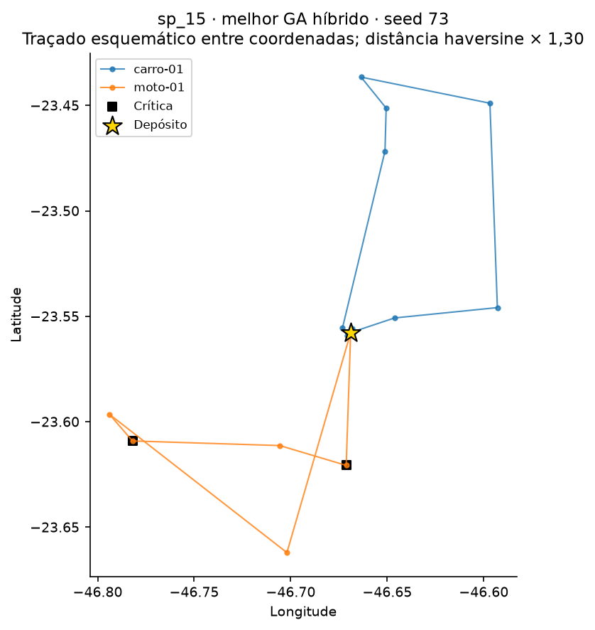
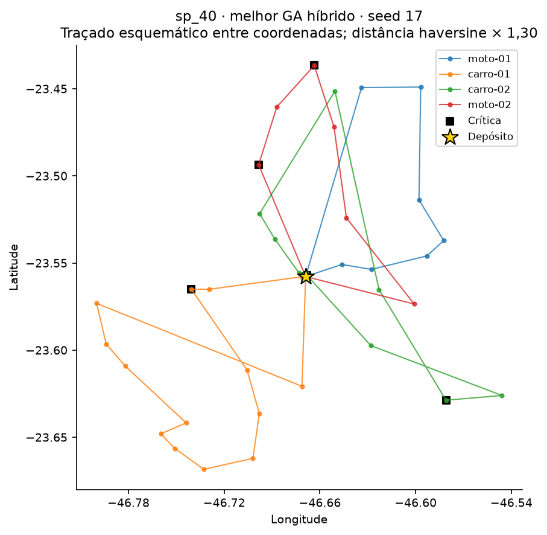
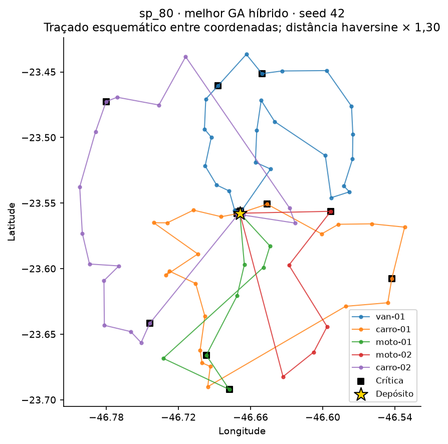

# Experimentos E1–E6 — entrega de Pedro em 23/10/2026

## Objetivo e método

Avaliar os parâmetros do GA, a sensibilidade aos preços de prioridade e o
comparativo com NN, NN+2-opt, Savings e aleatório. A rodada usa as coordenadas
atuais, a frota definitiva de 22/10 e o trânsito da `main` em `86276b9`.
Os resultados anteriores de S1/S2 continuam como histórico; não entram nas
estatísticas desta rodada.

Foram executadas 300 observações em `sp_15`, `sp_40` e `sp_80`, com as seeds
7, 17, 42, 73 e 101. Elas correspondem a 240 execuções únicas: a mesma referência
é reutilizada em E1, E2, E3, E5 e E6. Essa reutilização não aumenta a amostra
independente de uma configuração. Cada grupo tem cinco seeds; média e desvio
são descritivos, com desvio amostral (`n−1`), sem teste de significância.

O GA de referência é híbrido: população 100, 300 gerações sem parada antecipada,
crossover OX com taxa 0,9, mutação inversion com taxa 0,05, elitismo 2, torneio 3,
semente NN na população inicial e busca local por rota com probabilidade 0,3.
Todos os métodos usam o mesmo split, frota, atendimento de 10 min, trânsito
com saída às 07:00 e fitness, exceto a mudança explícita de preços em E5.
NN+2-opt pode aplicar até 100 passagens de primeira melhora pelo fitness.

Cada solução é recalculada a partir dos dados: cobertura das entregas e
unicidade de veículos, km com retorno, cargas, custo, duração, cronograma,
violações, penalidades e fitness. O manifesto registra hashes dos dados e
fontes, receitas, seeds, ambiente e hashes dos artefatos.

Fitness é custo generalizado em R$; menor é melhor. Ele soma custo operacional,
preços por minuto até a chegada e penalidades. Reduzir fitness não significa
reduzir o desembolso financeiro na mesma proporção. As tabelas completas
separam os componentes, km, duração total e máxima, frota usada, chegada das
críticas, atraso, jornada, tempo de execução e violações.

## E1 — população

Fitness médio ± desvio amostral, em R$:

| Instância | 50 | 100 | 200 |
|---|---:|---:|---:|
| sp_15 | 461,46 ± 0,48 | **456,39 ± 2,54** | 457,98 ± 3,41 |
| sp_40 | 1.177,31 ± 68,69 | 1.198,57 ± 58,01 | **1.091,26 ± 16,31** |
| sp_80 | **2.879,92 ± 279,83** | 2.884,40 ± 216,85 | 2.901,93 ± 57,75 |

População 200 melhora a média de `sp_40` em 8,95% contra 100 e reduz a dispersão.
Em `sp_15`, 100 apresenta a menor média. Em `sp_80`, as médias de 50 e 100 são
próximas; 200 reduz a dispersão, mas não a média. Aumentar a população não
garante melhor solução neste orçamento de gerações.

E1 mantém 300 gerações, portanto muda o orçamento nominal de avaliações:
15 mil, 30 mil e 60 mil posições avaliadas antes dos efeitos do cache. Não é
uma comparação com o mesmo número de avaliações nem um benchmark de tempo.


## E2 — taxa de mutação

| Instância | 0,01 | 0,05 | 0,15 |
|---|---:|---:|---:|
| sp_15 | 456,72 ± 2,79 | **456,39 ± 2,54** | 458,72 ± 3,80 |
| sp_40 | 1.116,56 ± 46,06 | 1.198,57 ± 58,01 | **1.070,07 ± 24,29** |
| sp_80 | 3.289,88 ± 338,39 | 2.884,40 ± 216,85 | **2.779,08 ± 39,71** |

Taxa 0,15 melhora as médias de `sp_40` e `sp_80` em 10,72% e 3,65%,
respectivamente, contra 0,05, com menor dispersão. Em `sp_15`, as três médias
são próximas e 0,05 tem o menor valor observado. A taxa baixa de 0,01 é
particularmente fraca em `sp_80`: preservar mais a população não compensa a
menor exploração neste desenho.


## E3 — crossover

| Instância | OX | PMX |
|---|---:|---:|
| sp_15 | 456,39 ± 2,54 | **455,27 ± 0,39** |
| sp_40 | 1.198,57 ± 58,01 | **1.193,74 ± 36,65** |
| sp_80 | 2.884,40 ± 216,85 | **2.756,37 ± 93,46** |

PMX tem a menor média nas três instâncias. A diferença é pequena em `sp_40`
(cerca de 0,40%) e maior em `sp_80` (4,44%), onde também cai a dispersão.
Cinco seeds sustentam a descrição desta rodada; não estabelecem superioridade
estatística geral do operador.


## E4 — operador aplicado com probabilidade 0,05

| Instância | swap | inversion | 2-opt local por rota |
|---|---:|---:|---:|
| sp_15 | 458,32 ± 1,63 | **456,26 ± 2,80** | 470,04 ± 4,62 |
| sp_40 | **1.199,21 ± 73,19** | 1.209,83 ± 26,97 | 1.256,95 ± 80,06 |
| sp_80 | 3.077,42 ± 302,20 | **3.027,83 ± 164,53** | 3.438,46 ± 305,11 |

E4 desliga a busca local adicional nos braços swap e inversion. No terceiro
braço, a mutação aleatória é zero e a operação é o 2-opt em km dentro de cada
rota, aceito somente quando melhora o fitness, com probabilidade 0,05.
Esse é o operador local do híbrido; não foi usada a mutação exaustiva de
inversões avaliadas pelo fitness (`mutation=two_opt`).

Inversion tem a menor média em `sp_15` e `sp_80`; swap, em `sp_40`, com mais
variação. O 2-opt por rota como única operação de mutação não melhora as médias
dos demais braços. Isso não reprova o GA híbrido: o híbrido combina inversion
e busca local a 0,3, enquanto E4 testa cada operação isolada a 0,05. Operações
em km dentro da rota também não substituem a exploração de permutações e a
redistribuição entre veículos feita pelo split.


## E5 — sensibilidade dos preços de prioridade

Os perfis multiplicam os preços de prioridade por 0, 1 e 3, mantendo as
penalidades. “Custo-puro” inclui penalidades de deadline e jornada. Fitness
bruto de perfis diferentes não deve ordenar os resultados; `fitness_comum`
reavalia todas as rotas com os pesos oficiais do perfil equilibrado.

| Instância | Perfil | Custo operacional médio R$ | Prioridade com pesos oficiais R$ | Chegada média das críticas min | Fitness comum médio R$ |
|---|---|---:|---:|---:|---:|
| sp_15 | custo-puro | 273,82 | 301,08 | 98,16 | 574,90 |
| sp_15 | equilibrado | 306,10 | 150,29 | 51,00 | **456,39** |
| sp_15 | prioridade-forte | 389,07 | 108,47 | 30,98 | 497,54 |
| sp_40 | custo-puro | 594,14 | 667,26 | 86,00 | 1.261,41 |
| sp_40 | equilibrado | 770,28 | 428,29 | 35,73 | **1.198,57** |
| sp_40 | prioridade-forte | 858,83 | 365,97 | 31,33 | 1.224,79 |
| sp_80 | custo-puro | 1.173,61 | 1.921,59 | 107,68 | 3.157,61 |
| sp_80 | equilibrado | 1.149,26 | 1.708,01 | 85,84 | **2.884,40** |
| sp_80 | prioridade-forte | 1.224,27 | 1.584,09 | 78,86 | 3.037,37 |

O perfil forte antecipa a chegada média das críticas nas três instâncias e
aumenta o custo operacional contra o equilibrado. Em `sp_15`, a chegada cai
de 51,00 para 30,98 min, enquanto o custo sobe de R$ 306,10 para R$ 389,07.
O equilibrado tem a menor média sob o objetivo oficial nas três instâncias.

Em `sp_80`, custo-puro nem sequer encontra menor custo operacional que o
equilibrado neste orçamento de busca. O perfil forte também não garante
cumprimento das restrições soft: há violação em 5/5 seeds, com excesso médio
de jornada de 41,01 min e atraso agregado médio das críticas de 2,39 min.
No equilibrado, há excesso de jornada em 2/5 seeds (5,43 min em média), sem
atraso de críticas. Todos esses perfis preservam as restrições hard.

As curvas de E5 são normalizadas pelo fitness inicial de cada perfil. Uma
queda percentual maior nessa figura não significa melhor valor sob os pesos
comuns: o objetivo inicial e sua escala mudam entre perfis.




## E6 — GA contra os baselines

Fitness médio ± desvio amostral em R$:

| Algoritmo | sp_15 | sp_40 | sp_80 |
|---|---:|---:|---:|
| GA híbrido | **456,39 ± 2,54** | **1.198,57 ± 58,01** | 2.884,40 ± 216,85 |
| GA puro | 474,74 ± 19,13 | 1.325,65 ± 85,45 | 7.709,24 ± 1.551,27 |
| NN | 474,44 | 1.432,09 | 5.672,33 |
| NN+2-opt | 461,72 | 1.263,23 | **2.884,01** |
| Savings | 575,96 | 1.318,14 | 4.413,51 |
| Aleatório | 779,59 ± 68,36 | 4.030,68 ± 1.115,81 | 82.585,37 ± 13.157,13 |

NN, NN+2-opt e Savings são determinísticos nesta implementação; as cinco
seeds repetem o fitness, com desvio zero. Savings é a adaptação para frota
heterogênea descrita na entrega de 16/10, com split final compartilhado.

| Instância | Híbrido: V/E/D contra NN+2-opt | Redução da média do fitness | Melhor híbrido | Seed |
|---|---:|---:|---:|---:|
| sp_15 | 5/0/0 | 1,15% | 454,58 | 73 |
| sp_40 | 5/0/0 | 5,12% | 1.115,06 | 17 |
| sp_80 | 4/0/1 | −0,01% | 2.684,33 | 42 |

V/E/D usa as mesmas seeds e tolerância de R$ 0,0000001. Em `sp_80`, o híbrido
vence quatro seeds, mas uma execução pior eleva sua média para ligeiramente
acima do NN+2-opt. Não se deve declarar vitória pela contagem de seeds e
omitir essa média. O GA puro perde na média nas três instâncias; o híbrido
é uma combinação relevante do projeto, não um ganho garantido para todo caso.

O híbrido não viola restrições em `sp_15`/`sp_40`. Em `sp_80`, 2/5 execuções
ultrapassam a jornada; as cinco atendem todas as críticas no prazo e nenhuma
viola capacidade, autonomia ou compatibilidade. NN+2-opt tem violação soft
nas cinco repetições de `sp_80`: 0,58 min de atraso de crítica e 1,11 min de
excesso de jornada por execução. O aleatório de `sp_80` é inviável nas cinco
seeds, inclusive em restrições hard. A soma de penalidades explica grande
parte do seu fitness elevado.

Os três melhores híbridos da tabela têm penalidades zero. Eles geraram os
mapas esquemáticos abaixo. O melhor plano é diferente da média das cinco
execuções; escolher uma seed boa não demonstra robustez em todas as seeds.


E6 usa escala logarítmica. Linhas tracejadas são os valores finais médios dos
baselines; faixas nas curvas do GA mostram desvio entre seeds, não intervalo
de confiança.





## Auditoria da compatibilidade na base

A validação independente encontrou uma diferença entre o decoder da `main`
e `constraints.violacao_compatibilidade`: uma entrega refrigerada e volumosa
em uma moto recebe duas incompatibilidades no decoder, mas a função de
restrições conta uma entrega incompatível. A rodada conserva o fitness
efetivamente usado pela base `86276b9` e explicita as duas contagens em
`incompatibilidades_entregas` e `incompatibilidades_duplicadas`.

Isso ocorreu em duas soluções inviáveis do aleatório em `sp_80` (seeds 7 e
101), com R$ 1.000 adicionais em cada uma. `fitness_sem_duplicacao` reavalia
as rotas contando entregas únicas: a média do aleatório cairia R$ 400,00,
continuando muito acima dos demais métodos. Nenhuma solução dos GAs ou dos
outros baselines teve essa duplicação. O decoder não foi alterado nesta
rodada; o achado fica explícito para a manutenção da parte de restrições.

O executor passou a registrar o hash de seu código separadamente das fontes
do otimizador. As 229 soluções já concluídas foram revalidadas e reutilizadas
somente após conferir que fontes do solver, dados, parâmetros e seeds eram
idênticos. O executor original e o mapeamento de hashes ficam em
`reports/experimentos-s3/provenance/`; os metadados preservam qual executor
produziu cada solução. As onze execuções restantes foram concluídas após
esse ajuste da auditoria, sem alterar o algoritmo ou o objetivo da base.

## Entrega e reprodução

```bash
python -m medroute.experiments.study --workers 4
python -m medroute.experiments.study --render-only
medroute report reports/experimentos-s3/e6_solutions.json --inst sp_80 --periodo semanal --provedor mock
```

- [Tabelas completas](../experimentos-s3/resumo.md): média, dp, melhor,
  componentes, tempo e violações. Dados em `metrics.csv`, `summary.csv` e
  `paired.csv`; curvas compactadas por experimento em `convergence/*.csv.gz`.
- [Manifesto de validação](../experimentos-s3/validacao.json), soluções,
  design e metadados permitem conferir a proveniência e refazer a análise.
- Dez figuras estão disponíveis em PNG e PDF em `reports/figuras/s3/`.
- O notebook `notebooks/02_experimentos.ipynb` apresenta os resultados com
  saídas salvas e confere os hashes dos artefatos.

Os tempos foram medidos no computador local sob concorrência: 38 execuções
foram concluídas com quatro processos e a retomada usou oito. Não são um
benchmark isolado nem sustentam inferências de aceleração. As distâncias são
haversine × 1,30, com traçado esquemático entre coordenadas; não representam
trajetos reais em ruas. As cargas, prioridades e destinos domiciliares são
simulados; parte dos custos da frota é uma premissa declarada.

PMX e taxa 0,15 são candidatos observados para instâncias maiores, enquanto
E1 mostra que aumentar a população pode apenas reduzir a dispersão. As
combinações desses tratamentos não foram ensaiadas; não se deve somar seus
ganhos individuais nem declarar uma configuração ótima geral. A entrega
mantém os parâmetros da aplicação e distingue o GA de referência de S3
(mutação 0,05) dos defaults da demo (mutação 0,2).
